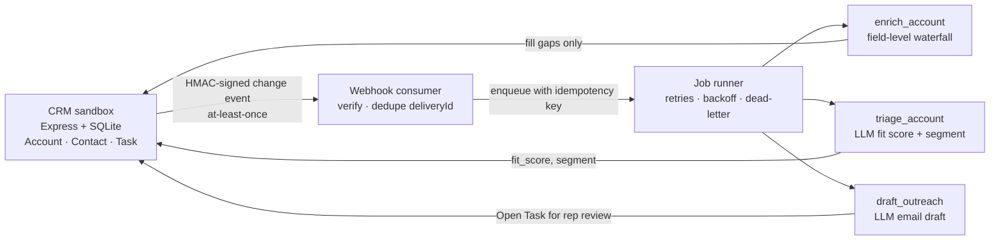

# RevPilot — GTM Workflow Engine

**A TypeScript go-to-market automation engine around a Salesforce-shaped CRM sandbox: signed change webhooks, an idempotent job runner, field-level waterfall enrichment across data providers, LLM account triage behind a validated schema, and first-touch email drafts that land as tasks for a human to send.**

Revenue teams glue together CRMs, enrichment vendors, and LLMs with brittle scripts that double-process events, overwrite good data, and occasionally email the wrong person. RevPilot shows the engineering that prevents that: every side effect is a retryable job, every webhook is verified and deduplicated, enrichment never clobbers CRM data, model output is validated before it touches a record, and nothing is ever sent without a person approving it.

## Engineering highlights

- **A CRM you can query safely.** The sandbox mimics Salesforce key-prefixed IDs (`001` Account, `003` Contact, `00T` Task) and a "SOQL-lite" `where` filter — `AND` only, four operators, whitelisted fields, values bound as parameters — so the filter can't be used for SQL injection.
- **Verified, deduplicated webhooks.** The CRM signs the exact bytes it sends with HMAC-SHA256 and retries up to three times. The consumer verifies against the raw body with a constant-time comparison and acknowledges repeated `deliveryId`s without reprocessing them.
- **Idempotent job runner.** Enqueueing a key that's already queued, running, or complete is a no-op. Failures retry with exponential backoff (1s, 2s, 4s, ±20% jitter) and dead-letter after four attempts.
- **Field-level waterfall enrichment.** Each field has its own provider priority, so one provider can win `industry` while another wins `annual_revenue`. Flaky providers contribute nothing instead of failing the job, and every field records which provider supplied it. A weighted quality score favors the fields that drive routing (headcount, revenue).
- **The CRM is the system of record.** Dedup matches on normalized domain first, then normalized name; enrichment only fills empty fields and never overwrites existing values.
- **Validate-then-retry for model output.** Triage must return `{fitScore 0–100, segment, reasons[]}`; drafts must be JSON with a body of at most 90 words. Violations are fed back to the model on retry, up to three times, before the job fails.
- **Human in the loop by construction.** Drafts are written as `Open` Tasks. No code path sends email or completes a Task.

## Enrichment in action

Running `enrich()` against the bundled mock providers:

| Account key | Field winners | Quality | Credits |
|---|---|---|---|
| `vantiq-systems.com` | all four from `primus` (no website source) | 0.90 | 4.5 |
| `meridianfreight.io` | website, industry, employees from `atlasgraph`; revenue, country from `fennec` | 1.00 | 4.5 |
| `northwind analytics` | website, industry, country from `atlasgraph` (`fennec` timed out on this call) | 0.40 | 4 |

The `fennec` provider fails every third call by design, which is why the third lookup is missing employees and revenue. Dedup also matches `https://www.vantiq-systems.com/about` to an existing `vantiq-systems.com` account by domain.

## Layout

| Path | Purpose |
|---|---|
| `crm/src/` | CRM sandbox: schema, REST routes with SOQL-lite filtering, signed webhook emitter, seed data |
| `engine/src/runner.ts`, `jobs.ts` | Typed job runner with idempotency and backoff |
| `engine/src/consumer.ts` | Webhook endpoint: signature verification and delivery dedupe |
| `engine/src/providers.ts`, `enrich.ts` | Mock data providers and the waterfall |
| `engine/src/normalize.ts`, `dedupe.ts` | Domain/name normalization, matching, gap-filling merge, CRM upsert |
| `engine/src/llm.ts` | LLM boundary with a deterministic mock that periodically returns invalid JSON |
| `engine/src/triage.ts`, `draft.ts`, `outreach.ts` | Fit scoring, email drafting, and Task creation |
| `engine/src/recipe.ts`, `recipes/` | Low-code recipe interpreter and an enrichment recipe |

## Docs

- [ARCHITECTURE.md](docs/ARCHITECTURE.md) — the event flow and the rules that hold it together
- [DECISION_MEMO.md](docs/DECISION_MEMO.md) — build vs. buy: custom enrichment code versus the low-code recipe
- [RUNBOOK.md](docs/RUNBOOK.md) — dead-lettered jobs, enrichment quality drops, webhook replays

## Status

The core modules work in isolation; the engine isn't assembled into a running service:

- **No `package.json` or `tsconfig.json`.** The CRM needs `express` and `better-sqlite3`; the engine needs `express`.
- **No entry point wires the runner to handlers.** The consumer enqueues `enrich_account` jobs, but nothing yet maps job kinds to the enrich, triage, and draft functions or chains them.
- **The recipe interpreter doesn't compile yet.** It imports `providers`, `ProviderName`, and `scoreQuality`, which `providers.ts` and `enrich.ts` don't export, and the recipe JSON names providers (`clearbit_like`, `web_scrape`, `peopledata_like`) that don't exist.
- The runner, delivery dedupe, and LLM are in memory; the runbook's SQL against a `jobs` table describes a persistent version not built here.
- No tests.
